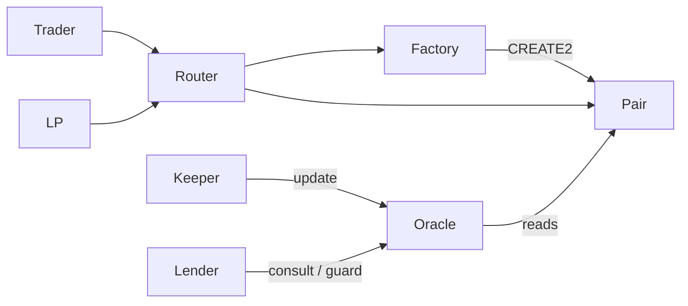
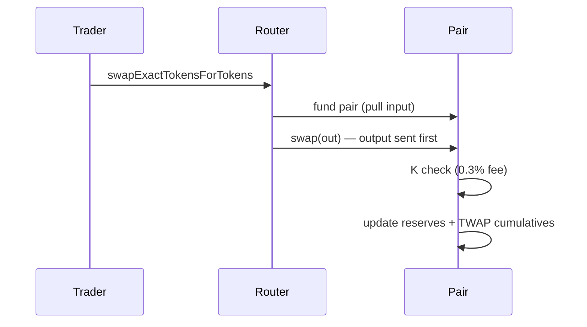

# Swap DEX — a security-focused Uniswap V2-style AMM

> "I took a Uniswap V2-style AMM and its TWAP oracle as an audit target. I
> threat-modeled it, found High-severity oracle-integrity and availability
> issues, wrote executable PoCs that drain a mock lending integrator and make
> `consult` uncallable, fixed them with a bounded ring buffer, freshness /
> fail-closed semantics and factory provenance, and proved the fixes with
> regression tests, invariants, fuzzing, and a professional report."

**This is a security-research portfolio piece, not production code.**
Self-audit; no professional review; not deployed on mainnet. See
[`docs/AUDIT_REPORT.md`](docs/AUDIT_REPORT.md) and [`SECURITY.md`](SECURITY.md).

## Findings summary (top 5)

| ID | Severity | Title | Proof |
|----|----------|-------|-------|
| H-01 | High | TWAP guard failed open on missing/short history | `test/exploits/OracleFailOpen.t.sol` |
| H-02 | High | Unbounded observations → consult DoS (~4.9M gas cold) | `test/exploits/OracleObservationDos.t.sol` |
| H-03/H-04 | High | Stale + short-window TWAP accepted | `OracleStaleTwap` / `OracleShortWindow` |
| H-05 | High | Fake pair prices the TWAP (no provenance) | `test/exploits/FakePairOracle.t.sol` |
| M-02 | Medium | Donation + sync drains spot lenders (666k on 100k) | `test/exploits/DonationSync.t.sol` |

Full inventory with severity, impact, PoC, fix, and verification:
[`docs/AUDIT_REPORT.md`](docs/AUDIT_REPORT.md).

## What this demonstrates

- Manual review + threat modeling → [`docs/THREAT_MODEL.md`](docs/THREAT_MODEL.md)
- PoC development + economic analysis (attacker cost vs victim loss, measured)
- Remediation without breaking the protocol (119/119 green, incl. CI profile)
- Regression, invariant (8/8), fuzz (independent math), adversarial testing
- Reporting: audit report, invariants, static-analysis triage, changelog

## Architecture





## Quickstart

```bash
forge build
forge test                                         # 119 tests, all green
forge test --match-path 'test/exploits/*' -vvv     # attacks blocked (15/15)
FOUNDRY_PROFILE=ci forge test                      # 5000 fuzz / 1000 invariant runs
forge coverage --ir-minimum --report summary       # ~97% lines on src/
make snapshot && make lint
```

## Security properties and limitations

- Oracle: 1,024-observation ring, 5-minute cadence, 1-hour freshness,
  15-minute minimum / ~85-hour maximum TWAP, fail-closed guard, factory
  provenance. `consult` returns Q112.112 raw units; use `consultScaled*`.
- `getSpotPriceUnsafe` is manipulable within a block — never back credit.
- Fee-on-transfer/rebasing tokens are NOT supported (failure modes pinned).
- Sandwiches are profitable on-chain: use `amountOutMin` + deadlines.
- No admin keys, no upgradeability, no protocol fee, no mainnet deployment.

## Reproduce the audit

1. Read [`docs/THREAT_MODEL.md`](docs/THREAT_MODEL.md) (assets, actors, abuse cases).
2. Run the exploits: `forge test --match-path 'test/exploits/*' -vvv`.
3. Compare pre-fix evidence: `docs/evidence/phase1-pre-fix-exploits.log`
   (7 secure-expectation tests fail, 2 theft demos succeed on the old tree).
4. Read findings: [`docs/AUDIT_REPORT.md`](docs/AUDIT_REPORT.md) (every High
   links code + PoC + fix + regression test + residual risk).
5. Check gates: invariants (`test/Invariant.t.sol`), fuzz
   (`test/SwapFuzz.t.sol`, independent `AmmMathRef`), coverage, gas snapshot.

## Deploy (local / testnet only)

```bash
cp .env.example .env          # fill PRIVATE_KEY, WETH_ADDRESS (non-local), ROUTER_ADDRESS...
forge script script/Deploy.s.sol            # infra only; refuses silent signers
forge script script/SeedLocal.s.sol         # testnet seeding; refuses mainnet
```

## License

MIT — see [LICENSE](LICENSE).
